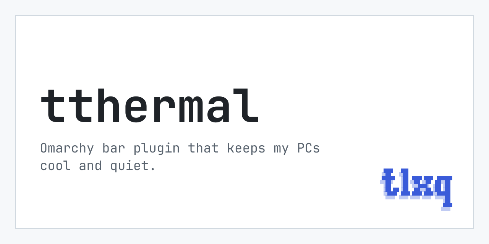
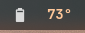
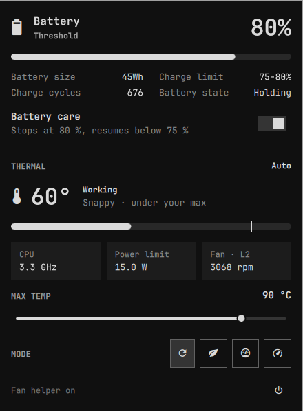
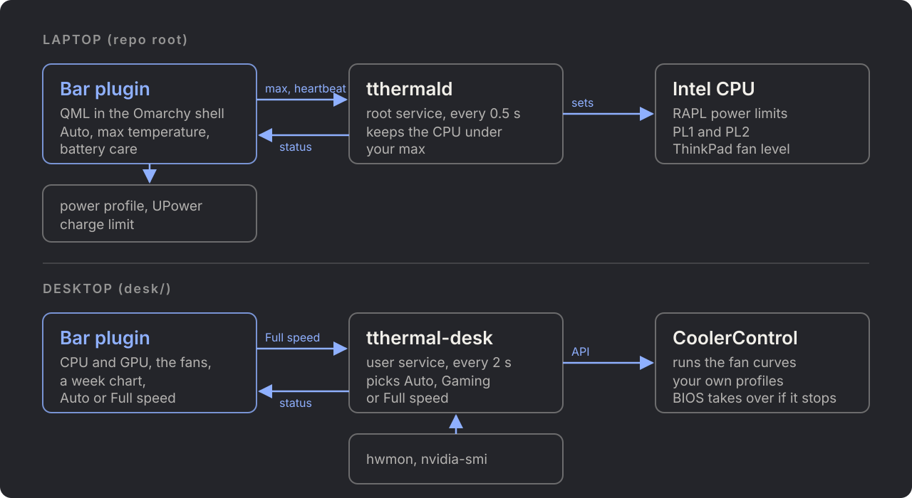

<picture>
  <source media="(prefers-color-scheme: dark)" srcset="docs/assets/banner-dark.svg">
  
</picture>

My [Omarchy](https://omarchy.org) bar plugin for keeping my two computers cool and quiet without picking power
profiles by hand: a ThinkPad T14s and an AMD/NVIDIA desktop. On the laptop it takes the battery icon's place and
keeps the CPU under one temperature I choose. On the desktop it shows CPU and GPU temperature and switches the fan
curves.

It's built for that hardware, not as a general tool. Read it for the idea, or use it as a starting point for your
own machine.

Checks run on my own PC before every merge: `mise run check`.

<p align="center">
  
  <br>
  
</p>

<!-- Desktop panel screenshot goes here: docs/assets/desk-panel.png. Not taken yet. -->

## Built for my machines

| Part | Needs |
|---|---|
| Laptop power limits | An Intel CPU with RAPL. Tuned on a ThinkPad T14s Gen 1 (i7-10610U). |
| Laptop fan | A ThinkPad (`thinkpad_acpi`) |
| Desktop temperatures | An AMD CPU with zenpower, an NVIDIA GPU, and a Gigabyte board (it8688 sensor) |
| Desktop fans | CoolerControl, with six fan profiles you make yourself |
| Desktop week chart | My own fan logger, which isn't in this repo |

On other hardware, start with the sensor and fan names at the top of `desk/bin/tthermal-desk`, and the limits in
`helper/tthermal.conf`.

## Why it exists

Omarchy gives you three power profiles. None of them says what I care about: how hot the laptop gets, and how
loud. So tthermal asks for one number, the highest temperature you accept, and does the rest. It runs quiet when
you're away or the lid is closed, fast when you work, and never above your number. It can also stop charging at
80 %, for a laptop that lives on the charger.

| State | When | Profile | Max |
|---|---|---|---|
| Working | keyboard or mouse in the last 2 min, lid open or an external screen | balanced | your max |
| Quiet | idle, or lid closed with no external screen | power-saver | your max |
| Background | quiet, but the CPU stays busy (transcodes, builds) | balanced | 70 °C |

Cool, Balanced and Fast lock a profile; your max still applies.

## What was hard

Keeping a CPU under a temperature without making it slow. Power profiles can't do it, so the root helper
`tthermald` steers the Intel power limits (RAPL, through the MMIO domain) twice a second:

- The burst limit (PL2) follows the headroom: a cool CPU gets the full burst, one close to the max gets none.
- The sustained limit (PL1) moves slowly and settles a long load just under the max.
- The limits never go above the values the firmware set at boot. They go back when the plugin's heartbeat
  stops, when the service stops, and on every restart.

The tuning came from measuring, not guessing. The scripts in `prototype/` ran burst and sustained-load tests on a
ThinkPad T14s. They showed the burst limit made no difference between 17 and 29 W, so it stays at 29 W. Two
fixes came later:

- Background mode flipped on and off on short CPU spikes. It now uses the CPU averaged over about 60 s, starts
  above 40 %, ends below 25 % and lasts at least 2 minutes.
- The helper itself used about 4 % of one core. It now reads values without starting programs, and does less
  while the CPU is far under the max: first 0.6 %, then about 30 % less than that.

`tests/tthermald.test.sh` runs the helper on fake sensor files and checks that 95 °C is caught within one tick.

## How it fits together

<p align="center"></p>

## Stack

QML (Quickshell, the Omarchy shell) · Bash · systemd · Intel RAPL · CoolerControl API · Node tests · ShellCheck

## Run it

You need Omarchy. There's no demo mode: the plugin shows your own machine's temperatures.

### Laptop (Intel)

Tested on a ThinkPad T14s Gen 1 (i7-10610U). Other Intel laptops with RAPL should work; fan control is
ThinkPad only.

```bash
git clone https://github.com/tlxq/tthermal.git ~/Projects/tthermal
ln -s ~/Projects/tthermal ~/.config/omarchy/plugins/com.ttdevs.tthermal
omarchy-shell shell rescanPlugins
OMARCHY_SHELL_IPC_TIMEOUT=10s omarchy plugin enable com.ttdevs.tthermal
```

tthermal takes the battery icon's place in the bar. Click **Turn on temperature control** in the panel (one
password prompt), or run `sudo ~/Projects/tthermal/helper/install.sh`. Check everything with
`~/Projects/tthermal/bin/tthermal-doctor`.

- Logs: `journalctl -u tthermal`, a status line every 10 s plus events.
- Tuning: `/etc/tthermal.conf`, with comments; apply with `sudo systemctl reload tthermal`.
- Back to Omarchy's battery icon: the power button at the bottom of the panel, or `bin/tthermal-off`. Power
  limits go back to factory and Omarchy's saved power profile returns. Remove the helper with
  `sudo helper/uninstall.sh`.

### Desktop (`desk/`)

Built for one desktop: AMD CPU (zenpower), NVIDIA GPU and a Gigabyte board (it8688 sensor). On other hardware,
change the sensor and fan names at the top of `desk/bin/tthermal-desk`.

1. Install [CoolerControl](https://gitlab.com/coolercontrol/coolercontrol) and make an access token with write
   access. Save it to `~/.config/ttdevs/coolercontrol.token`.
2. Bring your own fan curves: this repo doesn't ship any, since they depend on your case and fans. tthermal-desk
   switches between six CoolerControl profiles by id: `tt-cooler`, `tt-case` and `tt-intake` (Auto),
   `tt-game-top` and `tt-game-intake` (Gaming), and `tt-full` (100 %). The app gives new profiles random ids, so
   make these through CoolerControl's API (`POST /profiles` with a `uid`).
3. Run `~/Projects/tthermal/desk/install.sh`. It links `desk/` as the plugin and starts the user service.

The bar shows the hotter of CPU and GPU. Gaming turns on by itself when the GPU has been over 50 % busy for 30 s,
and Full speed goes back to Auto after 30 minutes. A game mode script can hold Gaming with
`desk/bin/tthermal-desk gaming` until `desk/bin/tthermal-desk auto` (or the Auto button). The week chart reads CSV logs from
`~/.local/state/desk-fanlog/`, one file per day. The logger isn't part of this repo; without it the chart stays
empty. Logs: `journalctl --user -u tthermal-desk`. Remove: `desk/uninstall.sh`.

### Checks

```bash
mise install
mise run check
```

ShellCheck, JSON, JavaScript syntax, the Node and helper tests, and `omarchy plugin validate` where Omarchy is
installed.

## Origin

`Panel.qml` and `Model.js` start from Omarchy 4.0.4's `shell/plugins/panels/power` (MIT).

## Licence

[MIT](LICENSE)
